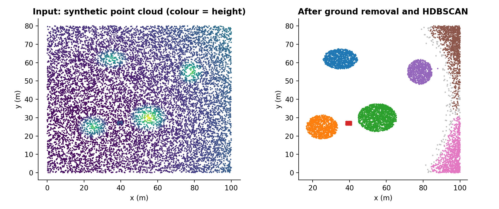
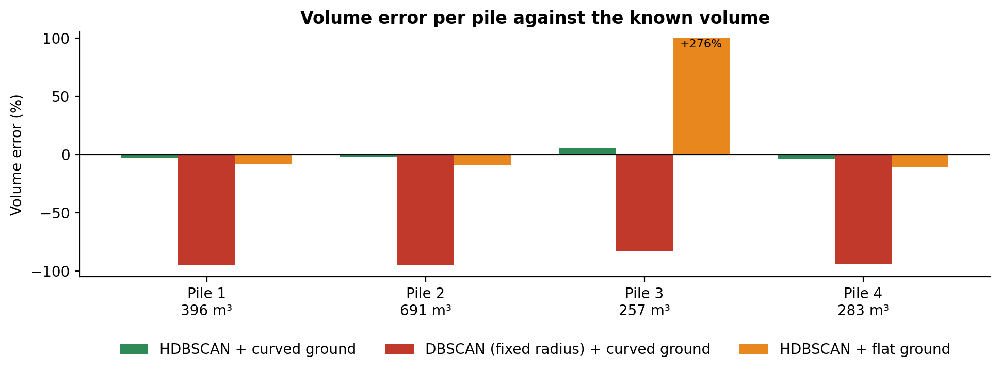
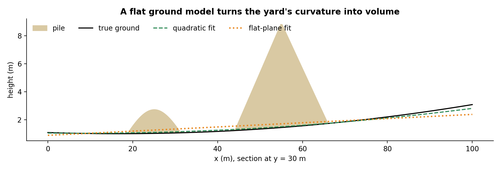

# Stockpile volume from drone photos

Measure stockpile volume from a drone point cloud: RANSAC ground, HDBSCAN piles, grid integration, checked against piles of known volume.

Companion code for the article **[How to measure stockpile volume with drone photos](https://lucas.rangeltech.net/articles/h1-measure-stockpile-volume-drone-photos/)**.

## The problem

Bulk materials sit in open piles: salt, ore, grain, gravel. A drone flight and photogrammetry (OpenDroneMap, for example) turn photos into a point cloud; this repository is the part that turns the point cloud into a volume per pile that a stock controller can trust.

The input here is a synthetic yard generated by the script: four piles of known shape on a sloped, slightly curved floor, with 5 cm of sensor noise and a loader parked between two piles. Because the piles are generated, their true volume is known, and every step can be checked.

> All data in this repository is synthetic, generated by the scripts with a fixed seed, with the shape of a real client problem. No client data, names or code are included.

## What the code does

1. **Find the ground.** RANSAC finds the dominant plane (the yard floor), then a quadratic surface is refit on its inliers, because real yards slope and dip.
2. **Keep what stands above it.** Points more than 30 cm above the ground surface are candidates; tall, narrow, sparse patches (machines, poles) are dropped so they don't bridge two piles.
3. **Separate the piles.** HDBSCAN clusters the points on their horizontal position. A fixed-radius DBSCAN is included for comparison.
4. **Integrate the height.** Height above the ground, averaged per 1 m grid cell, times the cell area, summed per pile.

## Results

| Variant | Clusters found | Volume error per pile |
|---|---:|---|
| HDBSCAN, curved ground | 7 (4 piles + 3 not stock) | −3.1%, −2.1%, +5.8%, −3.7% |
| DBSCAN with fixed radius, curved ground | 21 | −94.7%, −94.9%, −83.2%, −94.3% |
| HDBSCAN, flat ground | 6 | −8.7%, −9.4%, +276.1%, −11.1% |

The extra clusters in the first row (the loader and two strips along the yard edge) are why the product asks a person to confirm which clusters are piles.







## Run it

Python 3.11 or later.

```bash
pip install -r requirements.txt
python pipeline.py
python figures.py figures
```

## Files

| File | What it is |
|---|---|
| `pipeline.py` | scene generator and the four steps; prints true and estimated volume per pile, writes `results.json` |
| `figures.py` | regenerates the figures in `figures/` |
| `results.json` | the three variants above |

## License

Apache 2.0. See [LICENSE](LICENSE).
